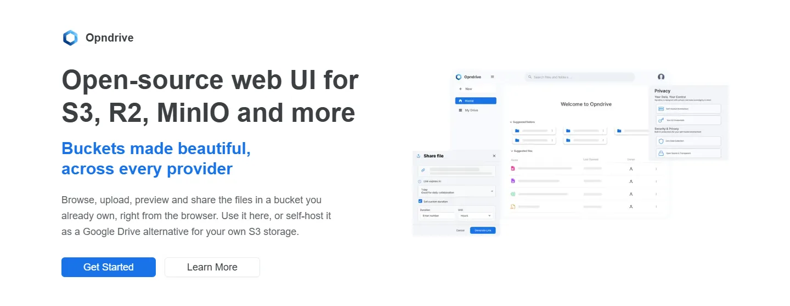
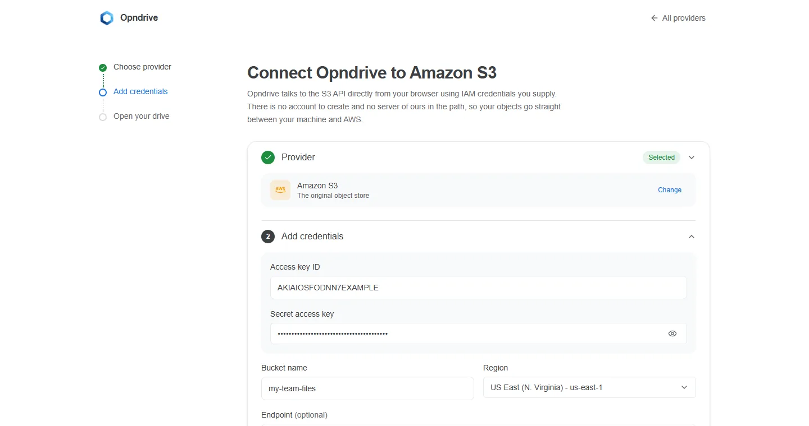
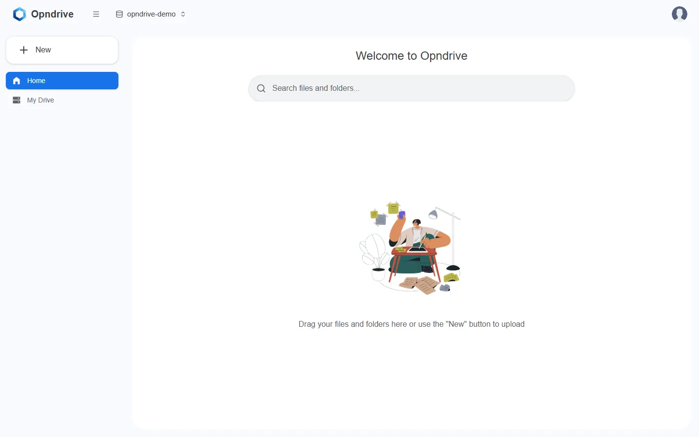

---
description:
  'Connect your S3 bucket on the /connect page and upload your first file, with
  where your credentials are kept and what to check if connecting fails.'
---

# First Upload

With Opndrive running locally ([Installation](./installation.md)), connect your
S3 bucket and upload your first file.



## 1. Connect Your Bucket

1. Click **Get Started** on the landing page. You'll land on `/connect`.
2. Fill in the form:
   - AWS Access Key ID
   - AWS Secret Access Key
   - AWS Region (for example `us-east-1`)
   - S3 Bucket Name
3. Click **Connect**. Opndrive verifies the credentials against the bucket, then
   redirects you to the dashboard.



Don't have an AWS account or bucket yet?

1. Create a free account at [aws.amazon.com](https://aws.amazon.com) (S3 has a
   free tier).
2. Create a bucket and generate access keys in the AWS console.
3. Give the bucket a CORS policy that allows the address you open Opndrive at.
   Without it the browser refuses every request and connecting fails with "Could
   not reach your storage". [Configure CORS](../guides/configure-cors.md) has
   the policy to paste.
4. Come back and connect through the form above.

Using Cloudflare R2, Wasabi, Backblaze B2, DigitalOcean Spaces or MinIO? Each
has its own page on [/connect](https://opndrive.app/connect) with its setup
steps; any other S3-compatible service uses the custom endpoint option. See
[Connecting Storage](../guides/connecting-storage.md).

## 2. Your Credentials, Your Browser

Opndrive has no backend and no database. Credentials you enter are stored in
your browser's `localStorage` and used to talk to S3 directly from there - they
never pass through an Opndrive-operated server. Click the user icon → **Clear
Session** at any time to remove them.

## 3. Upload a File



From the dashboard, use the upload button (or drag a file onto the file list).
See [Uploading Files](../guides/uploading-files.md) for the different upload
methods (direct, multipart, signed URL) and when each is used.

## Switching Buckets or Accounts

The two switchers at the top of the dashboard do this without signing out:

- The **bucket switcher** (showing the bucket name) moves to another bucket on
  the same keys.
- The **connection switcher** (to its left) moves to another saved connection.
  Its **Add connection** item opens the connect page for another account or
  bucket, and every connection you add is saved in this browser.

If uploads or deletes are still running, Opndrive asks before switching, because
switching cancels them.

## Stopping and Restarting the Dev Server

```bash
# Stop: Ctrl+C in the terminal running `pnpm dev:frontend`

# Restart later:
cd opndrive
pnpm dev:frontend
```

## Troubleshooting

**Connecting fails** - Opndrive shows one of a few messages, such as "Could not
reach your storage" or "Those keys were rejected", and the browser console (F12)
names the cause.
[Fixing Connection Errors](../guides/fixing-connection-errors.md) goes through
each one. The most common is a missing CORS policy on the bucket, which
[Configure CORS](../guides/configure-cors.md) covers for every provider.

---

**Next**: [Codebase Tour](../development/codebase-tour.md) if you're planning to
contribute, or [Uploading Files](../guides/uploading-files.md) to go deeper on
the upload flow.
