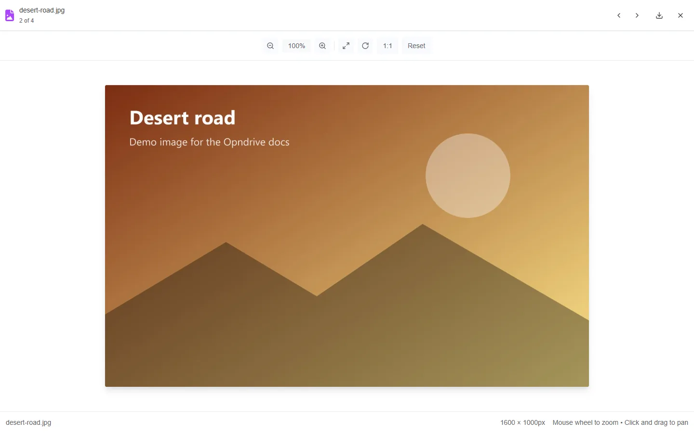

---
description:
  'Preview images, PDFs, video, audio, code and spreadsheets in Opndrive, either
  in a modal over the file list or on a preview page you can share.'
---

# Previewing Files

Opndrive supports two ways to preview a file, depending on whether you want to
stay in context or open it somewhere shareable.

|                | Modal preview                  | Route preview                        |
| -------------- | ------------------------------ | ------------------------------------ |
| How to open it | Click a file                   | "Open in new tab" from the file menu |
| URL            | Stays on the current page      | `/dashboard/preview/{etag}?key=...`  |
| Navigation     | Prev/next arrows between files | Single file, no prev/next            |
| Shareable      | No                             | Yes - it's a real, bookmarkable URL  |

Supported file types include images, PDFs, video, audio, text/code, and
spreadsheets.

## Route Preview and File Versions

The route preview URL is built from the file's S3 ETag, not just its path. If
the file changes after you copy the link, opening it again will detect the ETag
no longer matches and show an error rather than silently serving the new version
under the old link - the link is to a specific version of the file, not to
"whatever is at this path now."

## For Contributors

See [Preview Architecture](../development/preview-architecture.md) for how the
two preview modes share components and how the route is authenticated.
