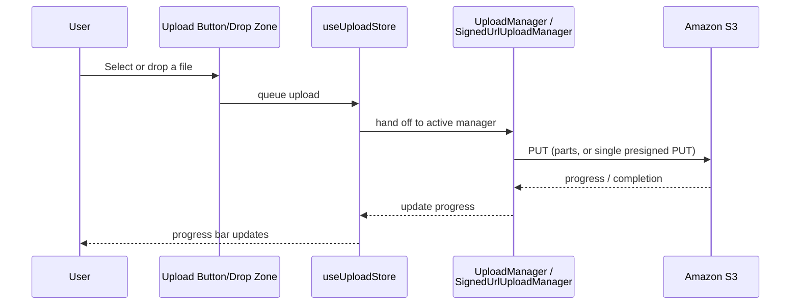
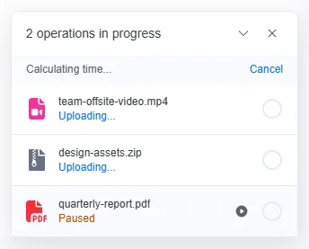

---
description:
  'Upload files and folders in multipart or signed-URL mode, pause and resume
  large uploads, and add the lifecycle rule that cleans up incomplete multipart
  uploads.'
---

# Uploading Files

Opndrive supports two upload modes. You choose between them in Settings, and the
choice is remembered (`upload-settings-storage` in `localStorage`).

| Mode                    | Best for    | Pause/Resume    | Notes                                                                               |
| ----------------------- | ----------- | --------------- | ----------------------------------------------------------------------------------- |
| **Multipart** (default) | Large files | Yes             | Splits the file into parts uploaded through `@opndrive/s3-api`'s multipart uploader |
| **Signed URL**          | Small files | No, cancel only | Single direct PUT against a presigned URL - less overhead, faster for small files   |

Both modes upload directly from your browser to S3 - no Opndrive-operated server
sits in between.

In multipart mode, a file that fits in a single 5 MiB part is sent in one
request rather than as a one-part multipart upload. That is fewer round trips
for small files, and it is the only way to upload an empty file at all: S3
refuses to complete a multipart upload that has no parts.

Parts are 5 MiB, except for very large files. S3 allows at most 10,000 parts in
one upload, so from about 48.8 GiB the part size grows just enough to fit, for
example 7 MiB for a 60 GiB file. A file too large for 10,000 parts of S3's 5 GiB
maximum (about 48.8 TiB) is refused before anything is sent.

If an upload fails for a reason that may clear by itself, such as a dropped
connection, a timeout or a busy server, it is tried again up to three times, 2,
8 and 30 seconds apart. While the browser is offline it waits for the connection
to come back instead of spending a retry. A multipart upload carries on from the
parts already sent rather than starting over. An upload that still fails, or was
refused outright (for example by a permissions error), shows **Retry** in the
upload panel.

Every upload records the file's Content-Type, in both modes. It is the type your
browser reports, or, when the browser reports none (common for HEIC photos and
some video formats on Windows), the type its extension implies. Without one, S3
stores a file as `binary/octet-stream`, and a shared link to a photo downloads
it instead of showing it.

## How the Mode Switch Actually Works

Switching modes in Settings updates a Zustand store
(`use-upload-settings-store`), which `context/zustand-bridge.tsx` watches and
uses to swap which manager (`UploadManager` for multipart,
`SignedUrlUploadManager` for signed URL) the upload store hands new uploads to.
See
[State Management](../development/state-management.md#where-context-meets-zustand-zustand-bridgetsx)
for the full wiring.

## Uploading





1. Click the upload button, or drag files onto the file list. Dragging a folder
   also brings its empty folders along, and an empty folder on its own is
   created as one. **Folder upload** in the New menu cannot do this, because
   browsers do not tell a page about empty folders chosen that way.
2. Track progress per file in the upload panel. A large dropped folder shows how
   many files have been found while it is still being read, then **Getting ready
   to upload** while it is checked against the bucket.
3. With multipart mode, pause and resume an in-progress upload; with signed URL
   mode, cancel is the only control mid-upload.

## Concurrency and Session Changes

Both upload managers are singletons scoped to your current session and bucket.
If you disconnect (Clear Session), switch buckets or switch connections,
in-flight and queued uploads are torn down along with the old manager rather
than continuing to target the previous bucket - this is intentional, not a bug:
uploading to the wrong bucket after a credential switch would be worse than
losing an in-progress upload. A switch asks first while anything is still
running.

## Required: Clean Up Incomplete Multipart Uploads

**Configure a lifecycle rule on your bucket before you rely on Opndrive for
large uploads.** This one is on you rather than on Opndrive, and skipping it
costs money quietly.

Multipart uploads work by sending a file in parts and then issuing a single
"complete" call that assembles them. If that final call never happens - the tab
is closed mid-upload, the laptop sleeps and the connection dies, the browser is
force-quit - the parts that already reached S3 stay there. Opndrive aborts the
upload cleanly whenever it gets the chance, but a closed tab gives the page no
time to send anything, so this case cannot be fixed from the browser. The
browser does ask before closing a tab that still has an upload running, which
catches the accidental close, but not a crash or a force-quit.

Orphaned parts behave badly:

- They do **not** appear in the Opndrive file list, or in the S3 console's
  object listing, or in `ListObjectsV2`. Only `ListMultipartUploads` sees them.
- They are **billed as stored data** for as long as they exist.
- Nothing removes them on its own. They persist indefinitely.

The fix is one bucket rule, and every S3-compatible provider supports it.

**AWS Console:** S3 → your bucket → Management → Lifecycle rules → Create rule.
Choose "Apply to all objects in the bucket", tick **Delete expired object delete
markers or incomplete multipart uploads**, then tick **Delete incomplete
multipart uploads** and set 7 days.

**AWS CLI:**

```bash
aws s3api put-bucket-lifecycle-configuration \
  --bucket YOUR_BUCKET_NAME \
  --lifecycle-configuration '{
    "Rules": [
      {
        "ID": "AbortIncompleteMultipartUploads",
        "Status": "Enabled",
        "Filter": {"Prefix": ""},
        "AbortIncompleteMultipartUpload": {"DaysAfterInitiation": 7}
      }
    ]
  }'
```

Seven days is a good default: long enough that a genuinely paused upload can
still be resumed, short enough that abandoned parts do not accumulate. Use 3
days if you upload very large files often. Do not go below 1 day, since the rule
cannot distinguish an abandoned upload from one that is merely slow.

Cloudflare R2, Backblaze B2, MinIO, DigitalOcean Spaces and Wasabi all accept
the same API call; check your provider's console for the equivalent setting.

To see whether you already have orphans:

```bash
aws s3api list-multipart-uploads --bucket YOUR_BUCKET_NAME
```

## Contributing to This Layer

The actual upload logic lives in `@opndrive/s3-api` (`UploadManager`,
`SignedUrlUploadManager`, `MultipartUploader`), not in the frontend. See
[S3 API Layer](../development/s3-api.md) for the implementation-level detail.
